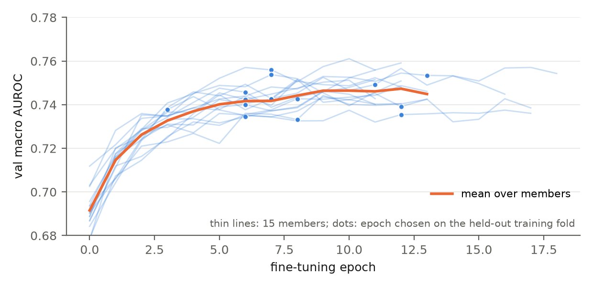
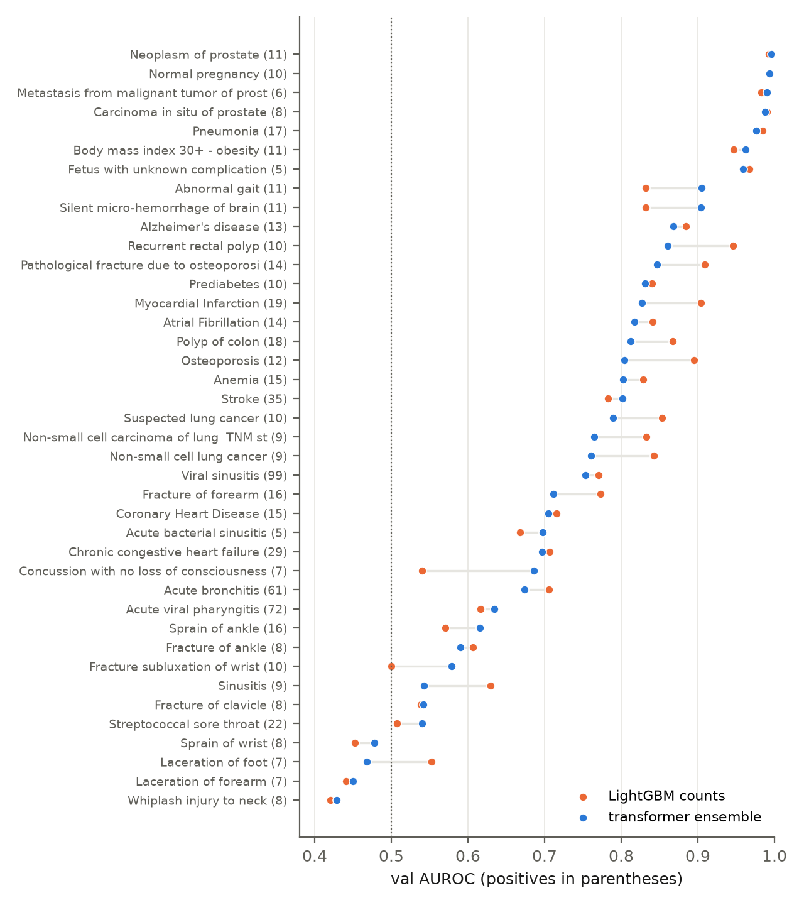

**Links.** Code: <https://github.com/Reaper8202/Research_Intern_Coding_Test>. Model package: <https://huggingface.co/Reaper8202/ehr-forecast>. wandb project: <https://wandb.ai/derek-wu820-university-of-toronto/ehr-forecast> (one member run, seed 1 fold 0: <https://wandb.ai/derek-wu820-university-of-toronto/ehr-forecast/runs/cfcff203c2910f92>).

## Summary

| Split | Model | Macro AUROC | mAP | At-risk AUROC |
|---|---|---|---|---|
| official val (365) | **submitted blend** | **0.767 [0.746, 0.788]** | **0.258 [0.234, 0.268]** | 0.739 |
| official val | transformer ensemble alone | 0.751 [0.730, 0.773] | 0.209 [0.192, 0.211] | 0.722 |
| official val | LightGBM counts alone | 0.762 [0.740, 0.781] | 0.239 [0.209, 0.249] | 0.733 |
| official val | logistic regression on codes | 0.764 [0.742, 0.782] | 0.222 [0.195, 0.229] | 0.733 |
| official val | age-sex incidence table (at-risk patients) | 0.727 [0.705, 0.751] | 0.141 [0.125, 0.146] | 0.696 |
| train CV, pooled out of fold | submitted blend | 0.774 (0.780 mean fold) | 0.212 | |
| test (358) | submitted blend | organisers' score | organisers' score | |

The submission is a blend of three models, all trained from scratch on the 2,791 training patients. Fifteen small decoder-only transformers (two layers, width 128, about 738k parameters each) were self-pretrained on pre-anchor event sequences and then fine-tuned on the 40 labels, three seeds across five cross-validation folds. Alongside them sit two LightGBM models on code counts, one of which also sees the latest value of each numeric observation. The three sets of logits are averaged, and a per-target Platt map fitted on training out-of-fold predictions scales the result. Macro AUROC and mAP average the per-condition AUROC and average precision over the 40 targets; the at-risk column scores each condition only among patients who did not already have it. The anchor is the date five years before a patient's last encounter, and the intervals in the table are 95% patient bootstrap intervals over 1,000 resamples. Test labels are hidden, so the test score is the organisers' to compute. From the validation and cross-validation numbers I would expect a test macro AUROC between 0.75 and 0.78 and an mAP between 0.21 and 0.26.

Over the course of the project, most of my effort shifted from the models to the pipeline around them. The truncation rule was checked against the released test files, every modelling choice was made by cross-validation on the training split with the adoption rules committed first, two independent audits checked every data boundary, and the validation split was read three times in all, with each read recorded. The sections below follow the four questions in the brief.

## 1. Representation

Each clinical event is one unit of input. Every row in the CSV tables that occurred before the anchor becomes a token made of its source, its event type, and its code, with the value folded in when there is one. A medication start is `med:start:310798` and a procedure is `proc:430193006`. A blood pressure reading becomes `obs:8480-6:mm[Hg]:q7`, which names the code, the unit, and the reading's place in the seventh of up to ten quantile bins, while a text result becomes `obs:72166-2:never_smoker`. Every other table gets the same treatment, and a patient's history is then a chronological sequence of these tokens, oldest first and about 170 long on average, introduced by a short prefix that holds the sex token, any genotype tokens, the MRI token, and a summary of older diagnoses.

For the fields, each table is read through a column allowlist, so a column that is not on the list never enters the pipeline. I dropped the columns that summarise the whole record rather than a moment in it: death date, lifetime healthcare costs and coverage, marital status, addresses, payer columns, and device UDIs, which encode manufacture and expiry dates. One particularly tricky column was medication dispense counts. On paper it is a retrospective count. In practice, even in the organisers' truncated test files, 873 of the 1,049 medications that extend past the anchor show more dispenses than months elapsed, which means the column counts future refills, so I dropped it. Race and ethnicity are also excluded; a LightGBM check confirmed that dropping them costs nothing measurable. Beyond demographics, I removed three observation codes, DALY, QALY, and QOLS. Synthea, the simulator that generated the data, logs these once a year starting in 2011, so their count works as a clock for the anchor year, and an early anchor in this dataset almost always means the patient died. That is not a temporal leak, but a model that reads it is learning how the dataset was built rather than anything about the patient. Removing the three codes cost about 0.014 cross-validated AUROC for the transformer and about 0.005 for the final blend, and I have kept that cost visible in the results rather than quietly absorbing it.

The brief also offered genomics and imaging as optional inputs, and the literature gave me a reason to use them. Soenksen et al. (2022) found that models combining structured records with imaging and other modalities outperformed single-source models on every task they tested in a MIMIC-based dataset, and Acosta et al. (2022) review a growing body of work in which each added modality carries information the structured record does not. I therefore encoded genotype files as one token per carried variant, and a brain MRI taken before the anchor as a single token produced by a small 3-D CNN trained from scratch, and I decided in advance to keep both inputs in the submitted model regardless of the result. In this dataset, however, the conditions under which multimodal inputs add value were largely absent. The genomics folder on the organisers' share could not be fully downloaded, so only 400 genotype files were available, 396 of them for training patients (the file names are recorded in `reports/dataset/modality_files.json`); scans existed for 200 training and 28 test patients; and the simulated volumes are practically identical brains, with almost no variation between patients for a model to learn from. The measured effect in cross-validation was a gain of 0.0005 AUROC overall and a loss of 0.003 on the 541 patients whose inputs actually changed. A later audit added a caveat: in this copy, having a genotype file correlates with outcomes, because the patients who have one are older and have more diagnoses, so the presence token could act as a proxy. Cross-validation says the network does not exploit it, and only two test patients have one. My reading is that the null result reflects the thin and homogeneous data rather than the inputs themselves. With complete genomics coverage and imaging that varied between patients the way real scans do, I would expect these inputs to carry the kind of signal the literature describes.

Continuous observations are binned into up to ten quantiles, with the bin edges fitted on each fold's training patients only. One token per event keeps sequences short, and recent tokenisation benchmarks for medical event models found fused quantile bins a sound default (Lee et al., 2026; McCann et al., 2026). I avoided external clinical thresholds, which might clash with how this synthetic dataset was generated, and kept measurement units separate, so a code measured in two units is two tokens; only five codes have more than one unit. Before committing to a lossy discretisation I checked with LightGBM whether the raw values carried more signal than the bins, and they did not (0.243 against 0.244 mAP).

Time between events is handled by giving every token the patient's exact age at that event. A normalised age (age/100) is combined with sine and cosine terms at eight periods from six months to 200 years, and the result is added to the token embedding, so the attention mechanism can read the gap between any two events rather than just their order. Order itself comes from rotary position embeddings. The prediction head is also given, directly, the time from the last event to the anchor, the patient's age at the anchor, sex, and a flag for an empty history.

Because attention cost grows with the square of the sequence length, inputs are capped at 1,024 tokens, keeping the most recent complete days. Chopping off the oldest records could lose a past myocardial infarction to hundreds of routine recent tokens, so any diagnosis that falls outside the window becomes one of up to 128 summary tokens at the start of the sequence, each keeping its first-diagnosis age. Exact medication refills, a stop and a restart of the same drug on the same day, are merged first; there were 160,150 of them in one fold. Only 4.6% of training patients are truncated at all, but they are the densest histories, and 15 to 18% of all event tokens fall outside the window. Contexts of 512 and 2,048 were screened on one fold and did not help.

Finally, the leakage controls. The brief's anchor sentence can be read four ways, and I simulated all four on train and val and kept the one whose gaps between last event and anchor match the released test files. The pipeline halts if a single post-anchor date survives the filter, a test adds a future record to a patient and checks that no prediction changes, and labels are built from the full record but never reach the prediction interface. Every fitted object, from the token vocabulary to the Platt maps, is fitted inside its own cross-validation fold, which the tests and two independent read-only audits checked.

## 2. Model and training

The model is a decoder-only transformer, structurally a miniature GPT: two blocks with a hidden dimension of 128, four causal attention heads, a feed-forward width of 512 with GELU, pre-LayerNorm, rotary position embeddings, and dropout of 0.3. Each token id is embedded as a 128-dimensional vector, with the 17 age features projected and added to it. The pretraining head scores every vocabulary token with tied weights, and the prediction head concatenates the state at the last clinical event with the mean state over all events, appends the four head features, and maps the result to 40 independent logits through sigmoids. The brain-MRI token's embedding comes from a four-layer 3-D CNN with 81k parameters. The whole network has 737,984 parameters, most of them in the embedding matrix for a vocabulary of about 1,930 tokens. With 2,791 training patients, overfitting is the main failure mode, so two layers by 128 was the default and scaling up needed a training-only reason. The one larger model I tried, four layers by width 192 with 2.26M parameters, reached a slightly lower pretraining loss but a worse fine-tuned score on the fold-0 screen, 0.758 against 0.772, so the small model stayed.

Training has two phases. The first is self-supervised pretraining on next-token cross-entropy over each patient's pre-anchor history, one random window per patient per epoch, with the start tokens of the 40 target conditions weighted five times in the loss so that the limited capacity goes first to the events that matter. The stopping loss comes from fixed windows of the fold's held-out training patients, never the validation set, and every run reached the 30-epoch cap with that loss still falling slowly, to about 1.5 nats per token. I did test pretraining on full timelines with post-anchor events included. It passed my adoption rule, and I still rejected it, because the brief says to truncate at the anchor. The second phase is supervised fine-tuning on binary cross-entropy over the 40 outputs. So that the model learns incidence rather than prevalence, cells where the patient already had the condition before the anchor are excluded from the loss and forced to zero at prediction. Each patient also contributes one extra example per epoch from an earlier cut day, drawn at random from the five years that end one window before the real anchor, with the labels rebuilt relative to that cut.

Both phases use AdamW with a batch of 32 patients and gradient clipping at 1.0. Pretraining runs at a learning rate of 0.001 with betas of (0.9, 0.95), weight decay of 0.1, and a 10% warm-up followed by cosine decay, for up to 30 epochs with a patience of 3, which never fired. Fine-tuning uses a learning rate of 0.001 for the head and a constant 0.0001 for the pretrained body, weight decay of 0.01, dropout of 0.3, and a patience of 5 on the held-out fold's masked macro AUROC. One fold takes about 20 minutes on a laptop.

Before any tuning I ran a three-way comparison to check that transfer was worth it: S trains from scratch with supervision only, H keeps the pretrained body frozen and trains only the head, and F fine-tunes the pretrained body and head together. F won on all five folds, with a mean AUROC of 0.760 against 0.744 for S and 0.742 for H, and a paired difference over S of +0.020 [+0.013, +0.028]. Pretraining helped, but only when the body was allowed to adapt.

To avoid chasing noise in the cross-validation folds, every tuning round was a budget file committed before its transformer runs, with one adoption rule: a mean AUROC gain of at least 0.005, higher on at least four of five folds, and an mAP loss of at most 0.005. Round 1 found that fine-tuning was overfitting, with training AUROC between 0.84 and 0.90 against 0.75 to 0.77 held out, and adopted dropout of 0.3, while a lower body learning rate, more weight decay, an age-sex head, longer pretraining, and longer contexts all failed. Round 2, run after the clock codes were removed, adopted the combination of the last-plus-mean readout, the extra anchors, and the target-weighted pretraining, which passed on five of five folds, while a count branch, per-target loss weights, and dropout of 0.5 failed. Three seeds of the winner, each with its own pretraining, give the 15 members whose probabilities are averaged. Round 3 tried the larger architecture described above and the blend described below. One note from the final audit belongs here: round 3's budget file was committed while its stacking job was already running, so its stacking and calibration rules cannot be shown to have been fixed before any number was visible, although the architecture screen started after the commit. The rules were not changed afterwards, and the blend passes them by margins well outside the intervals.

Alongside the transformer I trained an age-sex incidence table, an L2 logistic regression on code counts, and LightGBM on counts and on counts plus the latest numeric values, all tuned on the same folds; LightGBM's grid picked its simplest corner, 4 leaves and 100 trees, on the grid edge on all three axes, and I did not extend it. In training cross-validation the transformer ensemble and LightGBM counts were tied on AUROC, 0.761 against 0.764 pooled, while LightGBM led on mAP. To combine them I used nested stacking, and a parameter-free mean of the logits beat the transformer alone by +0.014 AUROC [+0.009, +0.019] and LightGBM by +0.011 [+0.007, +0.014]. A learned per-target logistic stacker gained only 0.001 more, under the 0.003 margin the rule had set, so the fixed blend stayed. Nested per-target Platt scaling then lowered the Brier score on four of five folds and the expected calibration error from 0.013 to 0.010 without changing any ranking.

{width=58%}

Figure 1 shows the training curves of the 15 members, and Figure 2 the validation curves: every saved epoch checkpoint of the 15 members scored on the official validation split after training, inside the frozen bundle. The epoch that each held-out training fold chose sits near but mostly before the validation optimum. The validation optimum is later than the chosen epoch in 13 of 15 members, and choosing epochs on validation would have gained 0.008 AUROC on average; the epochs were left as the training folds chose them.

{width=40%}

The evaluation protocol is five-fold cross-validation on the training split with patients never shared across folds, giving one out-of-fold prediction per patient from the models that did not fit on them, scored after the common prior mask, with paired bootstraps for every difference. The official validation split was scored only through a frozen bundle, a script that hashes every artifact, refuses to run on a modified tree, and refuses a second run without a written reason. The bundle ran twice, once for the standalone transformer ensemble and once for the final blend, and the earlier logistic-regression and incidence baselines had scored validation once before the bundle existed, so the validation labels were read three times in all. There is a caveat that belongs with those numbers. Round 3 used training cross-validation only, but the round was opened after the first bundle run had shown LightGBM ahead on validation mAP, so the second run is a second look at the same 365 patients rather than an independent check. The hidden test set is the independent check.

## 3. AI workflow

I started without any AI. I read the literature by hand (BEHRT, Med-BERT, ETHOS, Context Clues, and two 2026 benchmarks on tokenising medical events) and only then fed those papers to the models as context, so the AI reasoned from sources I had already read. Planning was a conversation rather than a prompt. In an interrogation-style session (the "grill me" workflow) the AI pressed on every part of the design, from what counts as a leak to when validation could be read, until I had answers I could defend. The result was a written plan with dated revisions, finished before the matching code existed, and the adoption rule for tuning was fixed in that plan before the first transformer result.

Implementation used two models, Codex (GPT Astra, via the Codex CLI) and Claude (Opus 5.5 and Fable 5.1 sessions, via Claude Code). I broke the plan into subunits small enough to test on their own, and each was implemented by one AI and then audited and tested by the other. I approved or rejected each decision that touched the data or the protocol and read the results before the next step.

Over time, the rule underneath all of this became clear to me: no AI output could be trusted until a different process had attacked it. The writer of a subunit was never its judge. The 199 tests were written to break the code rather than confirm it, including mutation checks such as changing `<` to `<=` in the anchor rule, which must fail a test. Every tuning round was committed before its scores, and at the end I had 74 audit criteria written and committed first, then applied by fresh sessions with no memory of the project that could read the repository but not edit it. Their verdicts came from the files rather than from the implementing sessions' account of them, and that is how the three findings I would least have wanted a reviewer to make first were made, each now disclosed where it belongs: the genotype-file correlation, the death-window signal that survives the clock-code removal, and the mis-dated round-3 budget. The AI wrote more lines than I did, but the data boundary, the selection rules, and every call that changed the data or the protocol were mine, and the decision log is where that claim can be checked.

## 4. Interpretation

The model is strongest where Synthea leaves a visible pathway. Seven targets score above 0.95 on validation: neoplasm of prostate, normal pregnancy, prostate metastasis, prostate carcinoma in situ, pneumonia, obesity, and fetus with unknown complication. PSA tests come before the prostate codes, contraceptives before pregnancy, dementia care plans before pneumonia, and a leakage review of every score above 0.98 found a pre-anchor cause in each case.

The transformer's weak spot is the count-driven conditions, where it loses to LightGBM: recurrent rectal polyp, myocardial infarction, pathological fracture, osteoporosis, and colon polyp. In Synthea the risk of these conditions grows with the number of specific earlier events, and a count feature states that number directly, whereas the transformer must infer it from a window that drops 15 to 18% of event tokens, and drops them for exactly the dense histories where the counts are high. The blend closes most of the gap (myocardial infarction 0.827 to 0.927, osteoporosis 0.804 to 0.883, pathological fracture 0.847 to 0.911); the lung-cancer codes stay below LightGBM.

In contrast, the transformer leads where order and timing matter: the paired brain targets, silent micro-haemorrhage and abnormal gait, where it scores 0.905 against 0.832 (the two labels are identical because one Synthea module emits both), and also heart failure, stroke, and concussion. The blend keeps most of that lead (0.892 on the brain pair) and on validation is above the transformer on 29 of 40 targets and above LightGBM on 17. The two models fail on different targets, and that is why the blend works. Figure 3 shows every target.

{width=36%}

Nine targets, the acute injuries and infections, score below 0.6 for the blend, and five of them do so for every model including the age-sex table, because Synthea generates them with almost no dependence on the prior record. They cap the macro average. Even an oracle that picks the better of the transformer and LightGBM for each target reaches only 0.778 in cross-validation, so I see no route to a macro AUROC of 0.80 on this data without the clock codes.

There is also a death window. Because the anchor is five years before the last encounter, an anchor before 2015 almost always means the patient died by the end of the record (1,155 of 1,219 such training patients). The signal survives the clock-code removal, since age and the clinical codes still predict an early anchor with an AUROC of 0.876, and it is concentrated: 43.7% of training patients have a pre-2015 anchor, and nine targets, the prostate and lung-cancer codes, heart failure, pneumonia, and myocardial infarction, have at least 90% of their positives in that group. On training out-of-fold predictions those nine score 0.925 overall but 0.879 when ranking only within the pre-2015 group, and the 40-target mean falls from 0.745 to 0.718 within it. In other words, part of each model's score comes from separating patients in their last five years from the rest; the within-group numbers are the fairer measure.

**What the transformer reads.** To check that the sequence model uses sequence and time rather than a bag of codes, I re-scored the seed-1 members on their held-out training folds with one kind of input removed at a time (`reports/interpretation/`; no validation read). The one-seed baseline is 0.755 macro AUROC.

| Input removed | Change in macro AUROC |
|---|---|
| event order (events shuffled within the sequence) | -0.016 |
| age gaps (every token given the same age) | -0.015 |
| observation tokens | -0.013 |
| procedure tokens | -0.007 |
| encounter, condition, medication, or care-plan tokens | -0.002 to -0.004 |
| summary tokens, or the head's recency input | 0.000 |

Order and timing are the two largest single contributions, larger than any one source of tokens, which is consistent with where the transformer beats the count models (one seed, no intervals). Observations are the most used source. What surprised me was the summary tokens and the recency input, both of which I expected to matter and which contribute nothing measurable; only 4.6% of patients are truncated at all, so the summary rarely changes a prediction. Token attribution on the same folds mostly returned what the pathways predict (female sex for pregnancy, early-onset Alzheimer's for pneumonia), while the tokens that raise many unrelated targets at once are markers of a patient near the end of the record, such as a terminal-care plan or a second cancer: the death window seen from inside the model.

On calibration, the Platt map corrects a slight under-prediction in the middle of the range, and the validation Brier score is 0.0365 for the blend against 0.0381 for the transformer alone. The data are synthetic and the anchor is retrospective, so nothing here is evidence about clinical use. The validation split is small, with an interval about 0.04 wide and eleven targets that have at most eight positives. The cross-validation number is optimistic, because the chosen configuration is the best of 28 transformer configurations and three stackers on the same folds, which is why mean-fold CV (0.780) sits above validation (0.767). And the LightGBM setting sits on the edge of its grid, which I did not extend.

If I were to take this further, I would start with what the evidence points at rather than with a bigger model. The transformer's losses are on count-driven conditions, so the first change would be to the representation: explicit tokens for how many times a repeated event has occurred and how recently, so the sequence model can read what the tree model counts. The second would be to extend the ablation and attribution analysis per target and across all three seeds. The third is procedural: extend the LightGBM grid past its edge under a new pre-registered budget, redo the modality test with a complete genomics folder, and hold validation to a single read. None of these would move the 0.80 ceiling without the clock codes, but they would make the model that reaches 0.77 easier to interpret.

## 5. Reproduction

Run `make setup`, link the dataset to `data/raw` (restricting `genomics/` to the listed files), and then follow the `make` targets in the order the README gives, from `make dataset` to `make package`. The Hugging Face package holds the 15 checkpoints, 5 tokenizers, 80 LightGBM boosters, and the Platt weights, and the package's verify command rebuilt `predictions.csv` (358 rows by 40 code columns) exactly in a fresh virtual environment. Paired on validation, the blend beats the transformer by +0.016 AUROC [+0.002, +0.030] and +0.049 mAP [+0.033, +0.072], and LightGBM counts by +0.005 [-0.005, +0.016] and +0.019 [+0.002, +0.040].

## References

\begingroup\footnotesize

Acosta JN et al. Multimodal biomedical AI. *Nat Med* 28, 1773–1784 (2022). doi:10.1038/s41591-022-01981-2 · Lee I et al. Representation Before Training. arXiv:2604.16775 (2026) · Li Y et al. BEHRT. *Sci Rep* 10, 7155 (2020). doi:10.1038/s41598-020-62922-y · McCann KA et al. Continuous Value Tokenization. medRxiv (2026). doi:10.64898/2026.08.04.26359713 · Rasmy L et al. Med-BERT. *npj Digit Med* 4, 86 (2021). doi:10.1038/s41746-021-00455-y · Renc P et al. Zero shot health trajectory prediction using transformer (ETHOS). *npj Digit Med* (2024). doi:10.1038/s41746-024-01235-0 · Soenksen LR et al. Integrated multimodal AI framework for healthcare applications. *npj Digit Med* 5, 149 (2022). doi:10.1038/s41746-022-00689-4 · Wornow M et al. Context Clues. ICLR 2025. arXiv:2412.16178

\endgroup
