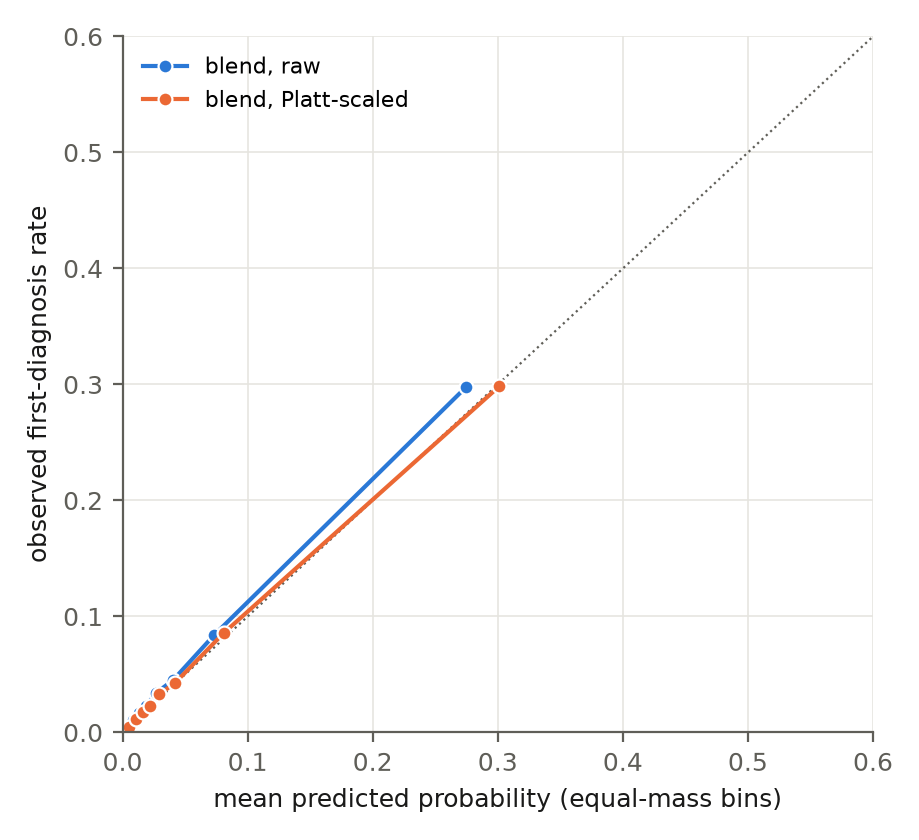

**Links.** Code and documentation: <https://github.com/Reaper8202/Research_Intern_Coding_Test>.
Trained model package: <https://huggingface.co/Reaper8202/ehr-forecast>.
wandb project (training, tuning, and val-curve runs): <https://wandb.ai/derek-wu820-university-of-toronto/ehr-forecast>.

## Summary

The submission is a blend of three models, all trained from scratch on the 2,791 training patients: fifteen small decoder-only transformers (2 layers, width 128, about 738k parameters each; three seeds times five cross-validation folds, self-pretrained on pre-anchor event sequences and then fine-tuned on the 40 labels) and two LightGBM models on code counts, one of which also sees the latest value of each numeric observation. Their logits are averaged, and a per-target Platt map fitted on training out-of-fold predictions scales the result. On the official validation split (365 patients) the blend scores macro AUROC **0.767 [0.746, 0.788]** and mAP **0.258 [0.234, 0.268]**; the transformer ensemble alone 0.751 / 0.209, LightGBM on counts alone 0.762 / 0.239. Test labels are hidden, so the test score is the organisers' to compute from `predictions.csv`. Most of the effort went into the pipeline rather than the models: a truncation rule checked against the released test files, column allowlists, one prior-condition mask shared by every model, every choice made by five-fold cross-validation on train with the adoption rules committed before the runs, two independent audits, and official val read three times in all, each read recorded.

## 1. Representation

Each clinical event is one unit of input. Every row in the CSV tables that occurred before the anchor became a token, formatted as its source, event type, and code, with the value folded in when there is one. A medication start is `med:start:310798`, a procedure `proc:430193006`. A blood pressure reading becomes `obs:8480-6:mm[Hg]:q7`: the code, the unit, and its place in the seventh of up to ten quantile bins. A text result becomes `obs:72166-2:never_smoker`. Encounters, immunizations, care plans, allergies, devices, and imaging studies get the same treatment. A patient's history is then a chronological sequence of these tokens, oldest first, with a median length of about 170, introduced by a short prefix: the sex token, any genotype tokens, the MRI token, and a summary of older diagnoses.

For the fields, each table is read through a column allowlist, so a column that isn't on the list never enters the pipeline. I dropped columns that summarise the whole record rather than a moment in it: death date, lifetime healthcare costs and coverage, marital status, addresses, payer columns, and device UDIs, which encode manufacture and expiry dates. One particularly tricky column was medication dispense counts. It looks retrospective, but it isn't. Even in the truncated test files, 873 of the 1,049 medications that extend beyond the anchor show more dispenses than months elapsed, so the column was counting future refills and giving the model a view past the anchor. I also excluded race and ethnicity. From a modeling perspective, the objective is to force the network to learn underlying physiological mechanisms and true clinical trajectories rather than relying on sociodemographic proxies, which often encode systemic biases rather than biological ground truth. A LightGBM check confirmed that dropping them had no measurable effect on performance (-0.002 AUROC, with the interval straddling zero).

Beyond demographics, I filtered out three observation codes: DALY, QALY, and QOLS. Synthea logs these once a year starting in 2011, so their count works as a proxy for the anchor year, and an early anchor in this dataset almost always means the patient died. Keeping them would let the model reverse-engineer how the dataset was built rather than learn clinical patterns. Although it isn't a temporal leak, it is a synthetic artifact that would compromise the model's validity. Removing them cost about 0.014 CV AUROC for the transformer and about 0.005 for the final blend. However, the true objective is generalizability in real patient data where this information would not be present.

For multimodal integration, genotype files are encoded as one token per carried variant, and a pre-anchor brain MRI is compressed into a single token through a small 3-D CNN trained from scratch. Coverage was thin: genotypes for only 396 training patients and 2 test patients, scans for 200 and 28, and the synthetic MRI volumes are practically identical brains. I had decided before seeing the result to keep the modalities in and submit the model either way, so the result is reported as it came out: +0.0005 AUROC overall in cross-validation, and -0.003 among the 541 patients who actually have the data. A later audit found something else worth stating. Having a genotype file at all correlates with outcomes: those files exist for 14.2% of training patients against 0.6% of val and test, and the patients who have one are older and have more new diagnoses, so the presence token could act as a proxy for outcome rather than carry any genetic signal. Cross-validation says the network doesn't exploit it, and only two test patients have one. The null result says more about this dataset than about the modalities. The simulated volumes carry almost no between-patient variation, and genotypes reach 396 training patients, so there is little for a model to learn from them here. On real clinical data, adding imaging and other modalities to structured records has improved prediction across tasks: Soenksen et al. (2022) found multimodal models outperformed single-source models on every task they tested in a MIMIC-based dataset, and Acosta et al. (2022) review the evidence and the open problems. Whether that holds at this cohort size with real genomic and imaging data is a question this dataset cannot answer.

To handle continuous numeric observations, I binned values into up to ten quantiles, calculated strictly within each fold's training patients. One token per event keeps sequences short, and the recent tokenization benchmarks for medical event models (Lee et al., 2026; McCann et al., 2026) found fused quantile bins a sound default. I deliberately avoided importing external clinical thresholds, such as defining hypertension at a static >130 mmHg. Hardcoded guidelines might clash with how this synthetic dataset was generated; data-driven quantiles force the network to find the boundaries that actually matter in this cohort. I also kept measurement units strictly separate: a code measured in two different units is two distinct tokens, never a conversion. Only five codes have more than one unit, so this costs almost nothing and removes a step that is a classic source of silent bugs. Before committing to a lossy discretization, I checked with LightGBM whether the raw, unbinned values carried more signal than the bins. They didn't: 0.243 versus 0.244 mAP.

To capture temporal dynamics, I embedded the patient's exact age at the event into every token. Language models assume a steady, uniform flow of words, but clinical events come in irregular bursts separated by days, months, or decades. Combining a normalized age (age/100) with sine and cosine terms across eight periods, from six months to 200 years, gives a continuous time encoding that lets the attention mechanism read the gap between any two events, not just their order. Order itself comes from rotary position embeddings (RoPE). Finally, the prediction head is fed directly the time elapsed from the last event to the anchor, the patient's age at the anchor, sex, and a flag for an empty history, so the final layer has the patient's current state without reconstructing it from attention weights.

Attention cost grows with the square of the sequence length, so I capped inputs at 1,024 tokens. Naive truncation, simply chopping off the oldest records, is dangerous. A patient could lose a past myocardial infarction because their recent history is cluttered with hundreds of routine tokens. So any diagnosis that falls outside the window becomes one of up to 128 summary tokens placed at the start of the sequence, each keeping its original first-diagnosis age. It works like the past medical history section of a real chart: chronic baselines stay, and the token budget goes to recent events. Exact medication refills, a stop and a restart of the same drug on the same day (160,150 of them in one fold), are merged first. Only 4.6% of training patients are truncated at all, but they are the densest histories, and 15 to 18% of all event tokens fall outside the window, mostly refills and encounters. Contexts of 512 and 2,048 were screened on one fold and didn't help.

Finally, treating temporal leakage was crucial. The brief's anchor sentence can be read four ways (whether history ends before the exact timestamp or the calendar day, and whether the anchor falls on that day or the next). I simulated all four on train and val and kept the one whose gaps between last event and anchor match the released test files. The pipeline halts if a single post-anchor date survives the filter, and a test adds a future record to a patient and checks that no prediction changes. Labels are built from the full record and never reach the prediction interface. Every fitted object, from the token vocabulary and quantile bins to the stacking weights and Platt scaling maps, is fitted inside its own cross-validation fold on the fitting patients only; the tests and two independent read-only audits checked each one. That's what lets me read the CV scores as generalisation to unseen patients rather than memorised dataset artifacts.

## 2. Model and training

**Architecture and capacity.** I implemented a decoder-only transformer, structurally a miniature GPT: two blocks with a hidden dimension of 128, four causal attention heads, a feed-forward width of 512 with GELU, pre-LayerNorm, rotary position embeddings (RoPE), and dropout 0.3. Each token id is embedded as a 128-dimensional vector, and the 17 age features pass through a learned linear projection that is added to it. Attention is causal, so each position attends only to earlier events, which is what makes next-event prediction well defined.

Two heads read the final states. The pretraining head uses tied weights (each state times the transposed embedding matrix) to score every vocabulary token, with input-only symbols masked out. The prediction head concatenates the state at the last clinical event with the mean state over all clinical events, appends four explicit features (age at anchor, sex, time since the last event, and a missing-history flag), and maps the resulting 260-dimensional vector to 40 independent logits through sigmoids. The brain-MRI token's embedding comes from a four-layer 3-D CNN (81k parameters) trained from scratch.

The whole network has 737,984 parameters, most of them in the token embedding matrix (about 1,930 vocabulary tokens). That is deliberate. With 2,791 training patients, overfitting is the main failure mode, so I fixed 2 layers x 128 as the default and required a training-only reason before scaling up. The one larger model I tried, 4 layers x width 192 (2.26M parameters), reached a slightly lower pretraining loss but a worse fine-tuned score on the fold-0 screen (0.758 vs 0.772 AUROC), so the small model stayed.

**Objective 1: self-supervised pretraining.** The first phase trains the network on next-token cross-entropy over each patient's pre-anchor history, one random window per patient per epoch. Start tokens for the 40 target conditions are weighted 5x in the loss, so the limited capacity goes first to the events that matter. The held-out stopping loss is computed on fixed windows from the fold's held-out training patients, never the val set. Every run hit the 30-epoch cap with that loss still falling slowly, to about 1.45 nats per token. Pretraining reads only history before the real anchor. I did test pretraining on full timelines, post-anchor events included; it passed my adoption rule and I still rejected it, because the brief says to truncate at the anchor.

**Objective 2: supervised fine-tuning.** The second phase optimises binary cross-entropy over the 40 outputs. So that the model learns incidence rather than prevalence, cells where the patient already had the condition before the anchor are excluded from the loss and forced to zero at prediction. The loss is accumulated over micro-batches of 8 to make a true batch of 32, then divided by the exact number of eligible cells. To get more labelled examples out of the same patients, each patient also contributes one extra example per epoch from an earlier cut day, drawn at random from the five years that end one window before the real anchor, with the labels rebuilt relative to that cut. This roughly doubles the labelled examples without any external data.

**Hyperparameters and the method comparison.** AdamW in both phases, float32. Pretraining: learning rate 0.001, betas (0.9, 0.95), weight decay 0.1, 10% warm-up then cosine decay to a tenth of the peak, gradient clip 1.0, batch 32, up to 30 epochs, patience 3. Fine-tuning: a differential learning rate of 0.001 for the head and a constant 0.0001 for the pretrained body, weight decay 0.01, clip 1.0, batch 32, dropout 0.3 in body and head, up to 30 epochs, patience 5 on the held-out fold's masked macro AUROC; the best epochs of the 15 members ranged from 3 to 13. A single fold (pretraining plus fine-tuning) takes about 20 minutes on an M-series Mac with 16 GB of memory, and the full 15-member ensemble took about 4.5 hours.

Before any tuning, I ran a three-way comparison to check that transfer was worth it:

* S: trained from scratch, supervision only.
* H: head only, pretrained body frozen.
* F: pretrained body and head fine-tuned jointly.

F won on all five folds: mean AUROC 0.760 vs 0.744 for S and 0.742 for H, pooled paired difference F minus S +0.020 [+0.013, +0.028]. Pretraining works, but only if the body is allowed to adapt.

**Tuning protocol and the blend.** To stop myself from chasing noise in the cross-validation folds, every round was a budget file committed before its transformer runs, with one adoption rule: a mean AUROC gain of at least 0.005, higher on at least four of five folds, and an mAP loss of at most 0.005. Round 1 found that fine-tuning was overfitting (training AUROC 0.84 to 0.90 against held-out 0.75 to 0.77) and adopted dropout 0.3; a lower body learning rate, weight decay 0.1, an age-sex head, 60 pretraining epochs, and contexts of 512 and 2,048 all failed. Round 2, after the clock codes were removed, adopted the combination of the last-plus-mean readout, the extra anchors, and the target-weighted pretraining, which passed on five of five folds; a count branch, per-target loss weights, and dropout 0.5 failed. Three seeds of the winner were trained, each with its own pretraining, giving the 15 fold models whose probabilities are averaged. Round 3 tried the larger architecture (above) and the blend (below).

One transparency note from the final audit. Round 3's budget file was committed at 21:18 on 3 November while its stacking job was already running and had written part of its output, so the stacking and calibration rules cannot be shown to have been fixed before any number was visible; the architecture screen started after the commit. The rules were not changed afterwards (the file's git history shows that), and the blend passes them by margins well outside the intervals.

Alongside the transformer I trained an age-sex incidence table, an L2 logistic regression on code counts, and LightGBM on counts and on counts plus the latest numeric values, all tuned on the same folds. LightGBM's grid picked its simplest corner (4 leaves, 100 trees, 20 patients per leaf), which is the grid edge on all three axes; I did not extend it. In training CV the transformer ensemble and LightGBM counts were tied on AUROC (0.761 vs 0.764 pooled), and LightGBM led on mAP. To combine them I used nested stacking: for each fold, the combiner is fitted on the other four folds' out-of-fold predictions. A parameter-free mean of the logits beat the transformer alone by +0.014 AUROC [+0.009, +0.019] and LightGBM by +0.011 [+0.007, +0.014]. A learned per-target logistic stacker gained only 0.001 more, under the 0.003 margin the rule had set, so the fixed blend stayed. Nested per-target Platt scaling then lowered Brier on four of five folds and expected calibration error from 0.013 to 0.010 without changing any ranking (a non-positive fitted slope falls back to the identity).

**Training and validation curves.** Training loss, learning rate, and gradient norm per step, and held-out metrics per epoch, for every run are in the wandb project linked above; the 15 members are the runs `small-v2-c1-fold<k>-F`, `small-v2-c1-seed2-fold<k>-F`, and `small-v2-c1-seed3-fold<k>-F`. Figure 1 shows the validation curves: every saved epoch checkpoint of the 15 members scored on the official val split after training, inside the frozen bundle. The epoch each member's held-out training fold chose sits near but mostly before the val optimum; choosing epochs on val instead would have gained 0.008 AUROC in 13 of 15 members. I did not make that choice.

{width=92%}

**Evaluation protocol and the frozen bundle.** Five-fold cross-validation on the training split (shuffled, seed 20261028, no stratification, patients never shared; the rarest target has 4 to 6 positives per held-out fold), with one out-of-fold prediction per patient from the models that did not fit on them. Macro AUROC and mAP over the 40 targets after the common prior mask, plus Brier score, with 95% patient-level BCa bootstrap intervals (1,000 resamples) and paired bootstraps for differences. Official val was scored only through a frozen bundle: a script that hashes every artifact, refuses to run if the source tree is modified, logs a start record before computing any metric, and refuses a second run without a documented reason. The bundle ran twice, once for the standalone transformer ensemble (0.751 / 0.209) and once for the final blend. The step-2 baselines had scored val once before the bundle existed, so the val labels were read three times in all, each read recorded. One caveat I'd rather state than have found: round 3 used training CV only, but it was opened after the first bundle run had shown LightGBM ahead on val mAP, so the second run is a second look at the same 365 patients rather than an independent check. The hidden test set is the independent check.

## 3. AI workflow

I started without any AI. I read the literature by hand (BEHRT, Med-BERT, ETHOS, the Context Clues paper on long-context EHR models, and two 2026 benchmarks on tokenising medical events), and only then fed those papers to the models as context, so the AI was reasoning from sources I had already read rather than from its own recollection of them.

Planning came next, and it was a conversation, not a prompt. I used an interrogation-style session (the "grill me" workflow) in which the AI pressed on every part of the design until we had an answer I could defend: what counts as a leak, how the anchor rule would be checked against the test files, which baselines had to be beaten before a transformer was worth training, how selection would work, and when to read val. The result was a written plan, with dated revisions that say what was known when each change was made, and it was finished before the matching code existed. The adoption rule for tuning (a mean AUROC gain of at least 0.005, higher on at least four of five folds, an mAP loss of at most 0.005) was fixed in that plan before the first transformer result.

Implementation used two models, Codex (GPT Astra, via the Codex CLI) and Claude (Fable 5.1 and Opus sessions, via Claude Code). I broke the plan into subunits small enough to test on their own: the anchor and truncation rules, the event table, labels and the prior mask, the fold tokenizer, sequence assembly, the model, the training loop with checkpoint recovery, the evaluation code, the LightGBM baselines, stacking, calibration, the frozen val bundle, and the package. Each subunit was implemented by one AI and then audited and tested by the other, which caught things a single model would have waved through. I reviewed every plan document, approved or rejected each decision that touched the data or the protocol, and read the results before the next step started.

Tests were the review: 199 of them, including mutation-style checks (changing `<` to `<=` in the anchor rule fails a test; a future record added after the anchor must leave every prediction unchanged; a resumed run must match an uninterrupted one; adding held-out rows must not change a fitted vocabulary). The commit log was the record: every tuning round was committed before its scores, so the selection rule could not be bent to fit a result. The data boundary was explicit: a table in the plan says what each operation may read, and the audit later checked every fitted object against it. And val was mechanically protected: the frozen bundle refuses to run on a changed tree, records every read, and needs a written reason for a second run.

The rule underneath all of this was that no AI output was trusted until a different process had attacked it. The writer of a subunit was never its judge, the tests I asked for were written to break the code rather than confirm it, and at the end I had audit criteria written and committed first, then opened fresh sessions with no memory of the project that could read the repository but not edit it. Their verdicts came from the files, not from the story the implementing sessions would have told, and that is how the three things I would least have wanted a reviewer to find first were found: that having a genotype file correlates with outcomes in this dataset, that an era signal survives the removal of the clock codes, and that the round-3 budget file was committed twenty minutes later than its header said. Each is disclosed where it belongs. The AI wrote more lines than I did; the data boundary, the selection rules, and every call that changed the data or the protocol were mine, and the decision log is where that claim can be checked.

## 4. Interpretation

**Where the model is strong.** Seven targets score above 0.95 AUROC on val. They are neoplasm of prostate (0.998), normal pregnancy (0.993), prostate metastasis (0.993), prostate carcinoma in situ (0.992), pneumonia (0.980), obesity (0.979), and fetus with unknown complication (0.964). Six of the seven are above 0.95 for the transformer and for LightGBM as well. Each one follows a visible Synthea pathway. PSA tests and rectal exams come before the prostate diagnoses. Contraceptive prescriptions come before pregnancy. Dementia care plans come before pneumonia. BMI observations come before obesity. A leakage review of every score above 0.98 found a pre-anchor cause in each case. These are easy targets for any model that reads the history.

**Where the blend repairs the transformer.** The transformer loses to LightGBM on count-driven conditions. These are recurrent rectal polyp, myocardial infarction, pathological fracture, osteoporosis, and colon polyp. In Synthea, the risk of these conditions grows with the number of specific earlier events, for example screening visits, bone-density tests, and nodule follow-ups. A count feature states that number directly. The transformer must infer it from a 1,024-token window. That window drops 15 to 18% of event tokens, and it drops them for exactly the dense histories where the counts are high. The round-2 count branch did not close this gap. A longer context did not help on fold 0. The blend closes most of it. Myocardial infarction moves from 0.827 (transformer) to 0.927 (blend). Osteoporosis moves from 0.804 to 0.883. Pathological fracture moves from 0.847 to 0.911. The three lung-cancer codes stay below LightGBM (0.806 to 0.823 against 0.833 to 0.854).

**Where the transformer leads.** The transformer leads on the paired brain targets, silent micro-haemorrhage and abnormal gait (0.905 against 0.832 for LightGBM). These two labels are identical for every patient, because one Synthea module emits both. It also leads on heart failure, stroke, and concussion. These conditions depend on the order and timing of events, which a bag of counts cannot see. The blend keeps most of this lead (0.892 on the brain pair). On val, the blend is above the transformer on 29 of 40 targets and above LightGBM on 17. The two models fail on different targets. That is why the blend works. Figure 2 shows every target for the blend and its two parts.

{width=74%}

**Where no model works.** Nine targets score below 0.6 for the blend: sinusitis, ankle sprain, wrist fracture-subluxation, clavicle fracture, foot laceration, strep throat, wrist sprain, forearm laceration, and whiplash. Five of them are below 0.6 for every model, including the age-sex table. Synthea generates these acute injuries and infections with almost no dependence on the prior record. No history model can rank them. They cap the macro average. Even an oracle that picks the better of the transformer and LightGBM for each target reaches only 0.778 in CV.

**The anchor era.** The anchor is five years before the last encounter. An anchor before 2015 therefore almost always means that the patient died by record end (1,155 of 1,219 training patients). Those patients have more new diagnoses (2.37 against 1.48). Removing the three clock codes removed the direct signal (era AUROC 0.999). An indirect signal remains in age and clinical codes (era AUROC 0.876 on fold 0). It cannot be removed without removing history. Scores split by era are similar for every model: blend 0.748 before 2015 and 0.746 from 2015 on val.

**Calibration.** Prior-condition cells are exact zeros. The raw blend under-predicts slightly in the middle of its range (Figure 3). The Platt map corrects this. On val, the Brier score is 0.0365 for the blend and 0.0381 for the transformer alone.

{width=58%}

**Limits.** The data are synthetic and the anchor is retrospective. Nothing here is evidence about clinical use. Val is small: the macro AUROC interval is about 0.04 wide, and eleven targets have at most eight positives. The CV number is optimistic: the chosen configuration is the best of 28 transformer configurations and three stackers on the same folds (mean-fold CV 0.780 against 0.767 on val). The LightGBM setting sits on the edge of its grid, and the grid was not extended. A macro AUROC of 0.80 is out of reach on this data without the clock codes.

## 5. Results summary and reproduction

| Split | Model | Macro AUROC | mAP |
|---|---|---|---|
| train CV, pooled out of fold | blend (submitted), before Platt scaling | 0.774 | 0.212 |
| train CV, pooled out of fold | transformer ensemble | 0.761 | 0.181 |
| train CV, pooled out of fold | LightGBM counts | 0.764 | 0.188 |
| **val** (365), attempt 2 | **blend (submitted)** | **0.767 [0.746, 0.788]** | **0.258 [0.234, 0.268]** |
| val, attempt 2 | transformer ensemble | 0.751 | 0.209 |
| val, attempt 2 | LightGBM counts | 0.762 [0.740, 0.781] | 0.239 [0.209, 0.249] |
| val, attempt 2 | LightGBM counts + values | 0.758 [0.740, 0.780] | 0.257 [0.228, 0.267] |
| val, attempt 2 | logistic regression, codes | 0.764 [0.742, 0.782] | 0.222 [0.195, 0.229] |
| val, attempt 2 | age-sex incidence, at risk | 0.727 [0.705, 0.751] | 0.141 [0.125, 0.146] |
| val, attempt 1 | transformer ensemble | 0.751 [0.730, 0.773] | 0.209 [0.192, 0.211] |
| test (358) | blend (submitted) | organisers' score | organisers' score |

Paired on val, blend minus transformer ensemble: AUROC +0.016 [+0.002, +0.030], mAP +0.049 [+0.033, +0.072]. Blend minus LightGBM counts: AUROC +0.005 [-0.005, +0.016], mAP +0.019 [+0.002, +0.040]. The comparison models' own intervals were computed after the bundle from its saved prediction files. `predictions.csv` holds 358 rows by 40 code columns.

Reproduction: `make setup`, link the dataset to `data/raw`, then `make dataset`, `make modalities`, `make folds`, `make tokenize`, `make pretrain` and `make finetune` per fold and seed, `make lightgbm` and `make lightgbm-clean`, `make stacking`, `make calibration`, `make lightgbm-final`, `make freeze`, `make val-score`, `make predict`, `make submission`, `make package`. The Hugging Face package carries the 15 transformer checkpoints, 5 tokenizers, 80 LightGBM boosters with their feature specs, and the Platt weights; `python -m ehrforecast.hf_package verify` rebuilds `predictions.csv` from it on CPU and reproduced it exactly, in the development environment and in a fresh virtual environment built from `requirements-lock.txt`.

## References

* Acosta JN, Falcone GJ, Rajpurkar P, Topol EJ. Multimodal biomedical AI. *Nature Medicine* 28, 1773–1784 (2022). <https://doi.org/10.1038/s41591-022-01981-2>
* Lee I, et al. Representation Before Training: A Practical Benchmark for Generative Medical Event Model Tokenization. arXiv:2604.16775 (2026). <https://arxiv.org/abs/2604.16775>
* Li Y, et al. BEHRT: Transformer for Electronic Health Records. *Scientific Reports* 10, 7155 (2020). <https://doi.org/10.1038/s41598-020-62922-y>
* McCann KA, et al. Continuous Value Tokenization Improves Medical Event Foundation Models. medRxiv (2026). <https://www.medrxiv.org/content/10.64898/2026.08.04.26359713v1>
* Rasmy L, et al. Med-BERT: pretrained contextualized embeddings on large-scale structured EHR for disease prediction. *npj Digital Medicine* 4, 86 (2021). <https://doi.org/10.1038/s41746-021-00455-y>
* Renc P, et al. Zero shot health trajectory prediction using transformer. *npj Digital Medicine* (2024). <https://doi.org/10.1038/s41746-024-01235-0>
* Soenksen LR, et al. Integrated multimodal artificial intelligence framework for healthcare applications. *npj Digital Medicine* 5, 149 (2022). <https://doi.org/10.1038/s41746-022-00689-4>
* Wornow M, et al. Context Clues: Evaluating Long Context Models for Clinical Prediction Tasks on EHRs. ICLR 2025. <https://arxiv.org/abs/2412.16178>
